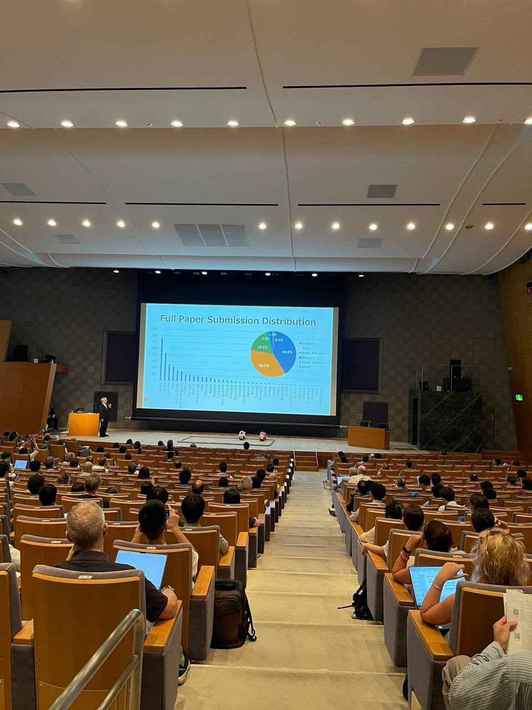
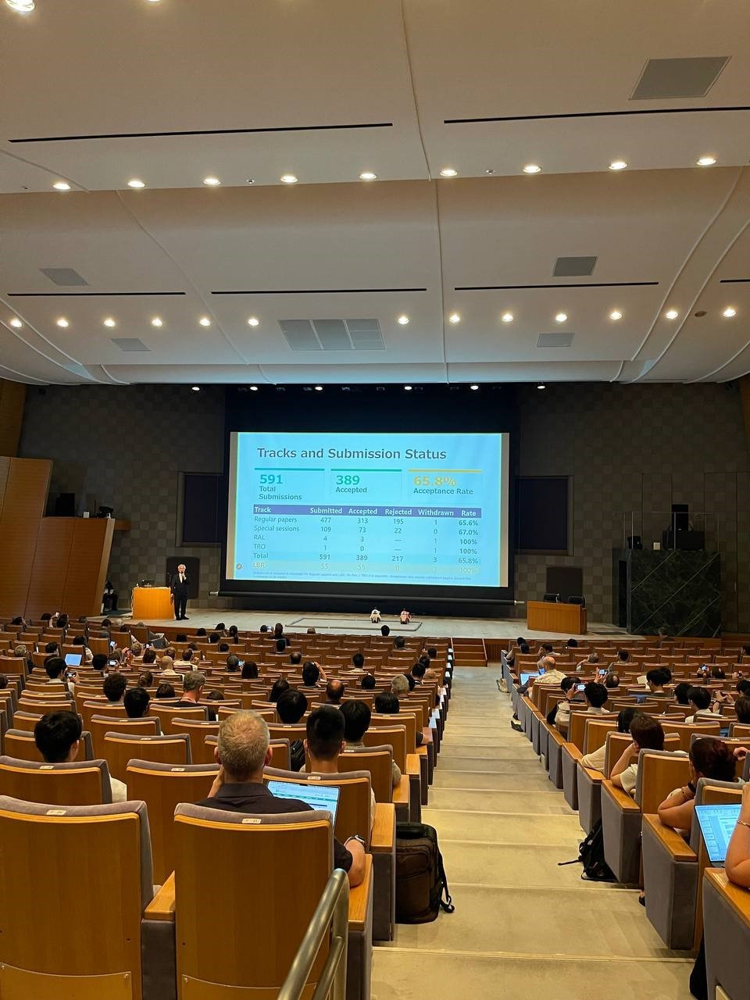
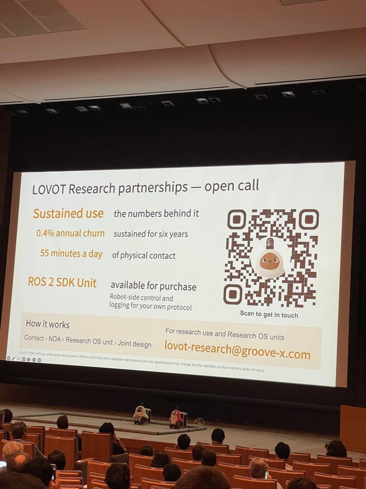
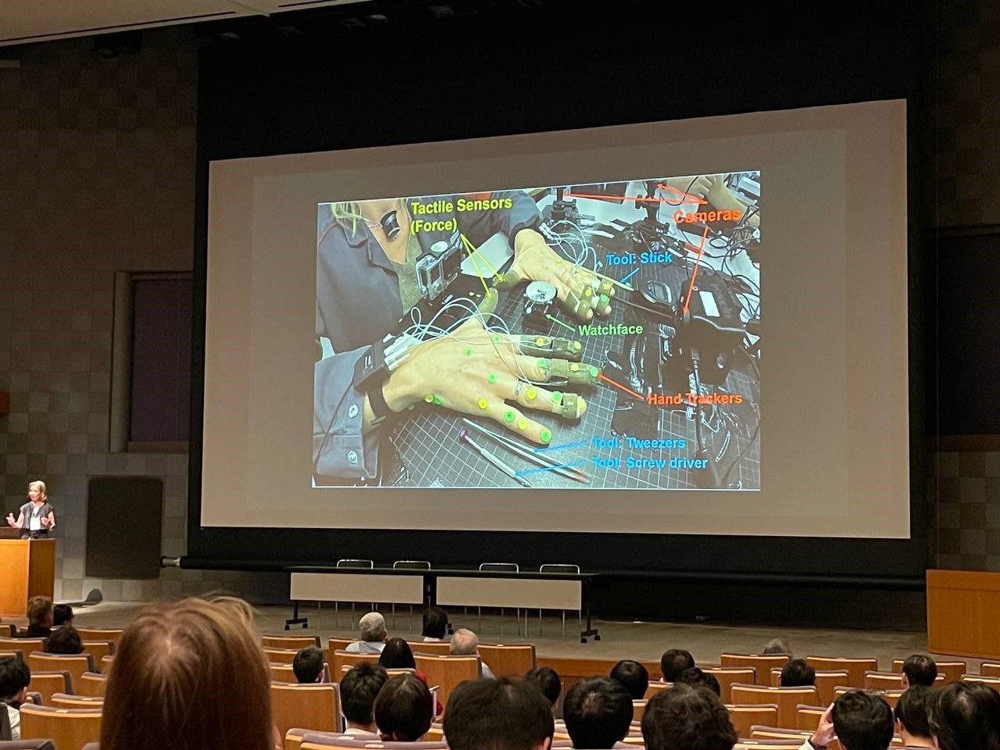
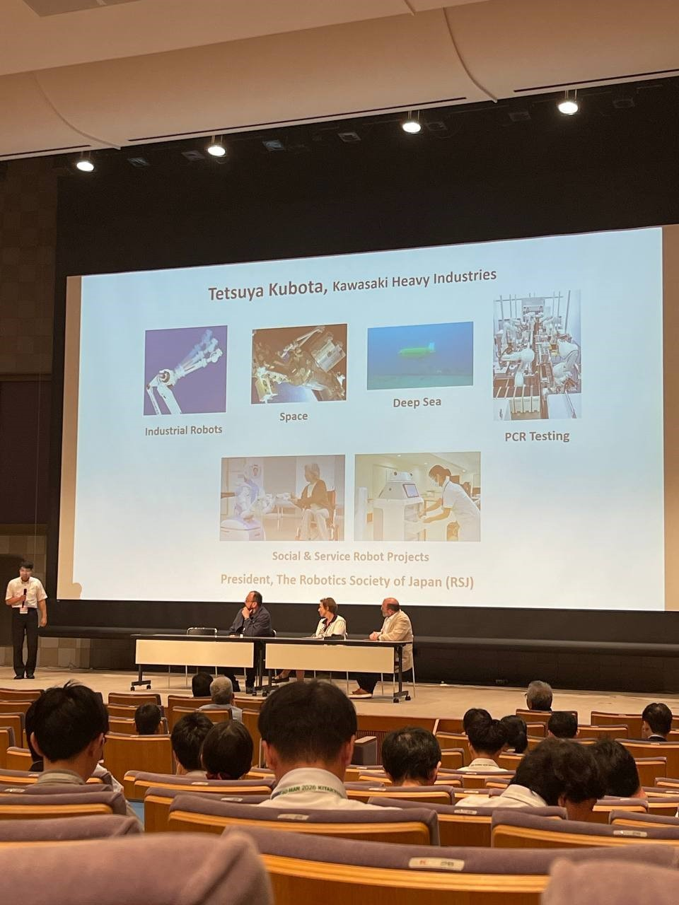
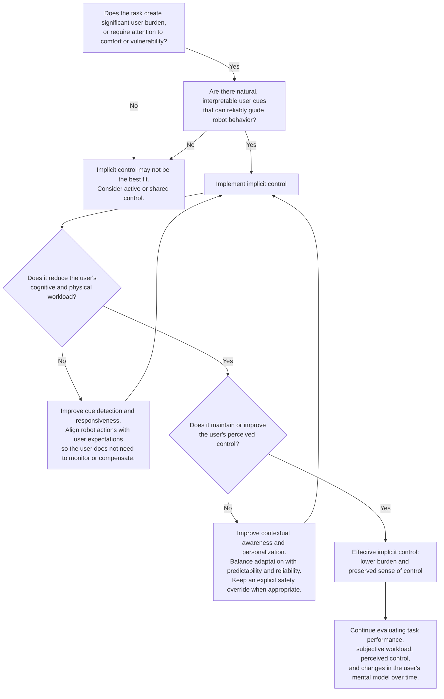
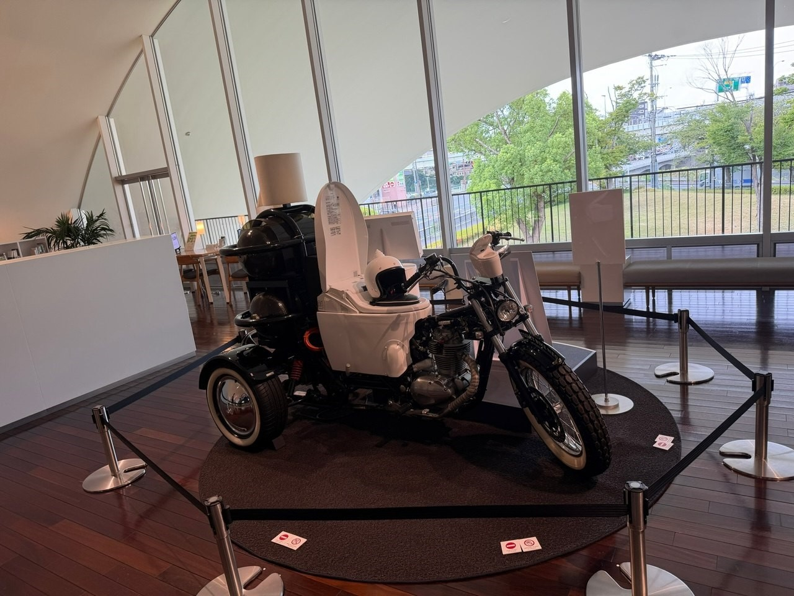

# IEEE RO-MAN 2026: Conference Notes and Selected Papers

  

**Kitakyushu, Japan · August 24–28, 2026**  
**Theme: _Realizing Human–Robot Symbiosis with AI_**

**Jump to:** [Conference overview](#conference-overview) · [Our paper](#croissant-paper) · [Paper index](#paper-index) · [Keyword map](#keyword-map) · [Paper summaries](#paper-summaries) · [TOTO Museum](#friday-activity-toto-museum)

## Conference overview

[RO-MAN](https://ro-man.org/) is the IEEE International Conference on Robot and Human Interactive Communication. Since the first conference in 1992, it has brought together researchers from robotics, artificial intelligence, psychology, design, and the social sciences to study how people and robots understand, assist, and adapt to one another.

The [35th RO-MAN conference](https://ro-man2026.org/call-for-papers/) was held at the Kitakyushu International Conference Center. Under the theme **“Realizing Human–Robot Symbiosis with AI,”** the program covered physical collaboration, social interaction, trust, well-being, and responsible deployment.

### RO-MAN 2026 at a glance

| Conference statistic | Count |
|:---|---:|
| Paper submissions | **591** |
| Accepted papers | **389** |
| Acceptance rate | **65.8%** |
| Countries and regions represented | **41** |
| Continents represented | **6** |

The five-day [conference program](https://ro-man2026.org/program-at-a-glance/) combined plenary talks, regular and special sessions, late-breaking reports, workshops, demonstrations, and panels. Topics ranged from robot dexterity and movement coordination to companion robots, healthcare, education, trust, explainability, and ethics.

  
  

*The opening session reported submissions from 41 countries and regions across six continents, with 389 papers accepted.*

### Plenary talks and industry panel

The three plenaries looked at human–robot interaction from the perspectives of emotional relationships, physical skills, and adaptive teamwork.

#### Kaname Hayashi — [“Warm Technology: Well-being Tech That Enhances Resilience”](https://ro-man2026.org/keynote-talks/)

Hayashi used LOVOT to describe a different goal for robotics: not greater efficiency or convenience, but emotional connection, well-being, and resilience. The talk traced the principles behind LOVOT and considered how robots might create value through empathy and long-term relationships with people.

**LOVOT links:** [official website](https://lovot.life/en/) · [moving through a home](https://www.youtube.com/watch?v=6DypYnwgv1M) · [greeting someone at the door](https://www.youtube.com/watch?v=wniBQXffb6c) · [*Oshiete! LOVOT* video guide](https://lovot.life/blog/article/oshiete-lovot)

#### Aude Billard — [“Toward Human-Like Dexterity for Robots and Beyond”](https://ro-man2026.org/keynote-talks/)

Billard focused on what robots need to work in environments built for human bodies. The techniques included learning from human demonstrations, sampling feasible grasps, extensive tactile sensing, variable impedance, bimanual coordination, and active compliance when sensing or positioning is uncertain. The talk ended with robots catching fast-moving objects at performance levels beyond human ability.

#### Stephen L. Smith — [“Adaptive Human–Robot Collaboration: Personalization and Multi-Agent Teaming”](https://ro-man2026.org/keynote-talks/)

The main theme was that robot autonomy should adapt to people rather than rely on a fixed division of control. In one-to-one collaboration, the robot estimates a person's preference to lead or follow and their current performance from recent task choices and errors, then replans who should do what. This was tested with a Fetch robot in a collaborative assembly task. The talk then extended the same idea to robot fleets: when one supervisor cannot help every robot at once, the system must decide where that person's attention is most useful and adjust when the supervisor is unavailable.

**Related publications behind Smith's talk:**

*Personalized collaboration and assembly*

- [*To Lead or to Follow? Adaptive Robot Task Planning in Human–Robot Collaboration*](https://doi.org/10.1109/TRO.2025.3582816) — *IEEE Transactions on Robotics*, 41:4215–4235 (2025). [Open manuscript](https://arxiv.org/abs/2401.01483).
- [*Human Leading or Following Preferences: Effects on Human Perception of the Robot and the Human–Robot Collaboration*](https://doi.org/10.1016/j.robot.2024.104821) — *Robotics and Autonomous Systems*, 183:104821 (2025). [Open manuscript](https://arxiv.org/abs/2401.01466).

*Human supervision and multi-robot teaming*

- [*Optimal Robot Path Planning in a Collaborative Human–Robot Team with Intermittent Human Availability*](https://doi.org/10.1109/RO-MAN57019.2023.10309646) — IEEE RO-MAN 2023, pp. 1048–1055. [Open manuscript](https://arxiv.org/abs/2307.04674).
- [*Scheduling Operator Assistance for Shared Autonomy in Multi-Robot Teams*](https://doi.org/10.1109/CDC51059.2022.9993014) — IEEE CDC 2022, pp. 3997–4003. [Open manuscript](https://arxiv.org/abs/2209.03458).
- [*Scalable Operator Allocation for Multi-Robot Assistance: A Restless Bandit Approach*](https://doi.org/10.1109/TCNS.2022.3153872) — *IEEE Transactions on Control of Network Systems*, 9(3):1397–1408 (2022). [Open manuscript](https://arxiv.org/abs/2111.06437).
- [*On the Impact of Interruptions During Multi-Robot Supervision Tasks*](https://doi.org/10.1109/ICRA48891.2023.10160323) — IEEE ICRA 2023, pp. 9771–9777. [Open manuscript](https://arxiv.org/abs/2306.16501).

The full abstracts and speaker biographies are available on the official [plenary talks page](https://ro-man2026.org/keynote-talks/).

  
  

*Left: LOVOT on stage during Kaname Hayashi's plenary on warm technology and well-being. Right: Aude Billard's plenary on human demonstrations, touch, and dexterous robot manipulation.*

The [industry panel](https://ro-man2026.org/industrial-panel/) addressed practical applications, natural interaction, system reliability, and the integration of generative and multimodal AI.

  

*The industry panel, “Realizing Human–Robot Symbiosis with AI,” in the conference main hall.*

## Would the Robot Cheapen Your Croissant? How Robots Impact Brand, Service and Quality Perception

Our RO-MAN 2026 paper reports an in-the-wild bakery study of how robot service and visible human craft shape service quality, brand experience, product quality, and willingness to pay. Customers received either an artisanal or mass-manufactured croissant from a person or a Franka Emika Panda robot, with or without a baker visible in the scene.

The result depended on the product and the surrounding experience. Robot service lowered the perceived quality of the mass-manufactured croissant, while the artisanal croissant remained highly rated regardless of who served it. Keeping the baker visible improved the broader experience and increased willingness to pay.

[Read the paper (PDF)](<Would the Robot Cheapen Your Croissant - How Robots Impact Brand, Service and Quality Perception.pdf>) · [View the presentation slides (PDF, 23 slides)](<Croissant Project Slide.pdf>)

## Selected papers

This collection brings together five papers from RO-MAN 2026 on implicit control, adaptive handovers, proactive assistance, shared autonomy, robot initiative, and personalized interaction.

Each summary covers the paper's main question, method, findings, and limitations. Author preprints and official program pages are included as external references.

### Paper index

| # | Paper | Main focus |
|---:|:---|:---|
| [1](#paper-1) | Control Without Control | Implicit control, assistive feeding, and user agency |
| [2](#paper-2) | Adaptive vs. Static Robot-to-Human Handover | Task-aware object presentation and workload |
| [3](#paper-3) | Spatio-Temporal Human Behavior Modeling | Proactive navigation and health interventions |
| [4](#paper-4) | Principled Authority Switching | Shared autonomy and human override behavior |
| [5](#paper-5) | When Should Robots Intervene? | Engagement, initiative, and intrusiveness |

### Keyword map

Numbers in parentheses refer to the papers below.

| Area | Keywords and paper numbers |
|:---|:---|
| **Movement, autonomy, and assistance** | **Assistive and Healthcare Robotics** (1, 3, 5) **Movement Coordination and Prediction** (1, 2, 3, 4) **Shared Autonomy and User Agency** (1, 4) **Trust, Workload, and User Experience** (1, 2) **Proactive and Context-Aware Assistance** (3, 5) |
| **Human factors and personalization** | **Engagement, Intrusiveness, and Personalization** (5) **Human Behavior Modeling** (3, 4) |
| **Communication and social interaction** | **Multimodal Interaction and Sensing** (1, 5) **LLM-Based HRI** (5) **Social and Service Robots** (3) |

## Paper summaries

### 1. Control Without Control: Defining Implicit Interaction Paradigms for Autonomous Assistive Robots

- **Authors:**
  - Janavi Gupta — Carnegie Mellon University
  - Kavya Puthuveetil — Carnegie Mellon University
  - Dimitra Tsakona — Imperial College London
  - Akhil Padmanabha — Carnegie Mellon University
  - Yiannis Demiris — Imperial College London
  - Zackory Erickson — Carnegie Mellon University
- **Session:** Cognition, Intent & Embodied AI VII
- **Presentation:** Thursday, August 27, 2026, 08:50–09:10
- **Paper:** [Author preprint on arXiv](https://arxiv.org/abs/2603.28079) · [Official program](https://ras.papercept.net/conferences/conferences/ROMAN26/program/ROMAN26_ContentListWeb_4.html#thg01_02)
- **Keywords:** **Assistive and Healthcare Robotics** · **Movement Coordination and Prediction** · **Shared Autonomy and User Agency** · **Trust, Workload, and User Experience** · **Multimodal Interaction and Sensing**

<!-- -->

- **What the paper asks:** Can an autonomous assistive robot act on natural human behavior without making the person feel that control has been taken away? The paper calls this **implicit control**: ordinary behavior becomes input to the robot even though the person does not issue a command for every action.
- **How the two systems differ:** They address different parts of assisted feeding.
  - **WAFFLE decides when to move the next bite.** An inertial measurement unit (IMU) and contact microphone mounted on glasses detect head motion and vibrations associated with chewing and speech. The system classifies the person as either **occupied** or **ready**. The Obi robot pauses on its predefined path while the person is chewing or speaking and advances when the person appears ready. It does not directly detect the thought “I want another bite”; the end of chewing or speaking serves as a readiness cue.
  - **CRAFTT decides how to deliver a bite already in progress.** RGB-D observations of facial micro-expressions, head movement, and gaze are compared with a user-specific affect baseline. A real-time multi-objective optimizer then updates the feeding arm's approach speed and final delivery distance to balance comfort, efficiency, and physical effort. Unlike WAFFLE, CRAFTT does not determine next-bite timing.
- **Evidence:** WAFFLE was studied with 15 participants without motor impairments and two with motor impairments, comparing implicit timing with a mouth-open command and a fixed timer in individual and social dining. CRAFTT was compared with a non-adaptive controller in a 26-person study. This paper reanalyzes the participants' open-ended responses from those studies rather than reporting a new experiment.
- **How people responded:** Participants often described the implicit policies as requiring less thought and less physical compensation. They could feel in control when the robot's response was intuitive, even if they could not explain the controller. That feeling depended on responsiveness, contextual awareness, personalization, and predictability—not simply on access to an explicit command. WAFFLE detection errors made some users monitor the robot more closely, while CRAFTT's fixed baseline led some users to adjust their own bodies to compensate for the robot.
- **Main takeaways from the design guidelines:**
  - **Use implicit control when it solves a real interaction problem.** It is most suitable when repeated explicit commands would be burdensome, or when the robot must respond to comfort and vulnerability in close-contact tasks. The user must also produce natural, interpretable signals that the robot can connect to an appropriate action. If those conditions are absent, explicit or shared control may be more appropriate.
  - **Reduce workload without reducing the person's sense of control.** Removing a button is not enough if the user must constantly watch the robot or change their behavior to compensate for it. The policy should be responsive, context-aware, and personalized while remaining predictable and reliable. More adaptation is not automatically better if it makes the robot harder to understand.
  - **Combine control methods when needed.** Implicit control can operate at different levels—for example, WAFFLE can govern bite timing while CRAFTT adapts the approach—and an explicit command or override can remain available for safety and unusual situations.
  - **Evaluate the experience as well as task performance.** Completion time and success rate cannot show whether the robot reduced effort or preserved agency. The authors recommend measuring perceived workload and control, using both quantitative ratings and qualitative interviews, and examining how users' mental models change with experience.

- **Implicit-control design flowchart:** Adapted from the decision tree and design guidelines in Section V.

- **Limitations:** The evidence comes from a secondary thematic analysis of two earlier feeding studies. Most participants did not have motor impairments, and a single researcher coded each study's responses. The proposed framework therefore still needs testing across other tasks and with people who rely on assistive robots in daily life.

---

### 2. Adaptive vs. Static Robot-to-Human Handover: A Study on Orientation and Approach Direction

- **Authors:**
  - Federico Biagi — University of Modena and Reggio Emilia
  - Dario Onfiani — University of Modena and Reggio Emilia
  - Simone Silenzi — University of Modena and Reggio Emilia
  - Cristina Iani — University of Modena and Reggio Emilia
  - Luigi Biagiotti — University of Modena and Reggio Emilia
- **Session:** Manipulation, Teleoperation & Handovers V
- **Presentation:** Wednesday, August 26, 2026, 17:20–17:40
- **Paper:** [Author preprint on arXiv](https://arxiv.org/abs/2604.22378) · [Official program](https://ras.papercept.net/conferences/conferences/ROMAN26/program/ROMAN26_ContentListWeb_3.html#wef07_04)
- **Keywords:** **Movement Coordination and Prediction** · **Trust, Workload, and User Experience**

<!-- -->

- **What the paper asks:** Does a handover become easier when the robot adapts both the delivery pose and the object's orientation to the recipient's hand and intended next task? The comparison is between a fixed handover pose and a task-aware presentation that leaves the useful part of the object accessible.

| Feature | Static handover | Adaptive handover |
|:---|:---|:---|
| **Delivery position** | Uses one predefined handover pose. | Computes the target from the recipient's measured hand position. |
| **Object orientation** | Remains fixed regardless of how the object will be used next. | Uses a task-specific orientation aligned with the recipient's hand. |
| **Approach direction** | Follows a predetermined approach to the fixed target. | Shapes the final approach using the direction of the recipient's palm. |
| **Downstream task** | Does not affect the handover pose. | Selects a grasp configuration for the stated task, such as drinking from, passing, or loading a mug into a dishwasher. |
| **Who adjusts?** | The person may need to reach awkwardly, rotate the wrist, or regrasp the object. | The robot adjusts the delivery so the person can move more directly into the next task. |

- **Robot policy:** A Franka Emika Panda arm estimates the receiver's 3D hand position and wrist orientation using an Intel RealSense camera, MediaPipe, FrankMocap, and Manotorch. In the adaptive condition, the measured hand pose is combined with a task-specific offset and object orientation obtained from a preliminary user study. The controller builds a cubic Bézier approach path, interpolates orientation with SLERP, uses a fifth-order time law to limit jerk, and checks the path for joint limits, singularities, and manipulability before execution. If validation fails, it shrinks the intermediate control points and checks again. The static policy ignores both hand pose and downstream task.
- **Study:** Fourteen right-handed participants completed both conditions with a mug and a smartphone. Each object had three downstream tasks. For the mug, the robot exposed the handle for drinking, left the handle available when the mug would be passed to another person, or presented the mug for a bottom grasp before dishwasher loading. The task label was supplied by the experimental protocol; only the receiver's hand pose was estimated online.
- **How people responded:** People experienced the adaptive handover as less demanding rather than broadly more trustworthy. It produced significantly lower weighted NASA-TLX workload scores (*t*(13) = −3.19, *p* < .01) and lower blink rates (*t*(13) = −2.73, *p* = .02), which the authors interpret as supporting evidence of lower interaction stress. Aligning the object with the hand and next task likely reduced the person's coordination effort, such as awkward reaching or regrasping, although those movements and direct system preference were not measured. Most trust, predictability, comfort, cooperation, and safety ratings did not differ significantly. The only trust-related difference that remained significant after correction was confidence that the gripper would not drop the object: 3.86 out of 5 for the adaptive system and 2.93 for the static system. The adaptive policy therefore reduced burden without producing a broad change in perceived trust or safety.
- **Policy and HRI takeaway:** Adaptation mattered most as a reduction in the person's coordination work: the recipient was less likely to need an awkward posture or a regrasp before the next task. The result also separates usability from general trust. A better motion policy lowered effort and stress, but most ratings of motion predictability, safety, and cooperation remained statistically similar.
- **Ethics responses:** Participants rated industrial and domestic handovers positively. Responses were not significantly above neutral, after correction, for AI-based environmental data extraction, letting robot reaction time influence a person's pace, or delegating physical safety to hardware, sensors, and control algorithms. Acceptance of the task therefore did not imply blanket acceptance of the sensing and control policy behind it.
- **Limitations:** The sample was small and uneven by gender—12 men and two women—and covered only two object categories. Participants had to keep their hands approximately stationary once the delivery pose was detected. The task was provided rather than inferred, and the authors report inference-speed and depth-estimation limits under unfavorable viewing angles and occlusion. The study therefore supports adaptive presentation in a controlled setting, not yet unconstrained handover to a moving recipient.

---

### 3. Spatio-Temporal Human Behavior Modeling for Opportunistic Health Interventions with Mobile Robots

- **Authors:**
  - Yunus Terzioglu — Northeastern University
  - Xiang Zhi Tan — Northeastern University
  - Timothy Bickmore — Northeastern University
- **Session:** Proactive Assistance & State Sensing I
- **Presentation:** Tuesday, August 25, 2026, 10:50–11:10
- **Paper:** [Official program](https://ras.papercept.net/conferences/conferences/ROMAN26/program/ROMAN26_ContentListWeb_2.html#tua08_01)
- **Keywords:** **Assistive and Healthcare Robotics** · **Movement Coordination and Prediction** · **Proactive and Context-Aware Assistance** · **Human Behavior Modeling** · **Social and Service Robots**

<!-- -->

- **What the paper asks:** Can a mobile robot reach a person at the moment a health decision is being made, rather than react after the decision is already over? The paper treats proactive assistance as a joint prediction-and-navigation problem: the robot must infer both **where** an opportunity will occur and **how early** it needs to leave.
- **Study design and participant tasks:** Fifteen participants each completed ten simulated “office days,” yielding 150 days, 1,191 activities, and 410 snack or drink opportunities. Before starting, each person wrote several schedule cards to create recurring but varied routines through five office areas. Every day began with check-in and ended with check-out. Participants completed two ordered work tasks—selecting a job candidate from résumés and then typing a short justification—and could schedule any number of one-minute rests, snack selections, and drink selections. At the pantries, they examined healthy and unhealthy options, chose what they would take, placed it in a basket, and logged the choice. Each participant experienced five reactive and five proactive robot days.
- **What Pepper does:** Pepper normally waits beside the work area. A Gaussian-process model uses the person's time-stamped 2D position to predict their trajectory up to two minutes ahead, and predicted paths are matched with the snack and drink areas.
  - **Proactive condition:** Pepper starts navigating only when the model predicts, at least 40 seconds in advance, that the person will remain in a snack or drink area for at least three seconds. The advance notice gives the physical robot time to arrive before a choice is made.
  - **Reactive condition:** Pepper waits until the person has already occupied a snack or drink area for three seconds before it starts moving, so it may arrive after the item has been selected.
  - **At the pantry:** If Pepper arrives before the selection, it recommends a randomly selected healthy item using a short scripted statement and nutritional reason: “What about a banana? Bananas provide potassium to help your kidneys and heart function properly.” It does not fetch the item or conduct a personalized conversation. If it arrives too late, it stays silent and returns home or moves toward the next predicted opportunity. For safety and repeatability, an experimenter approved navigation and manually confirmed whether Pepper should deliver the message.
- **How people responded:** The proactive robot successfully delivered 107 messages. It succeeded in 79.85% of the opportunities it actually attempted, compared with eight delivered messages and a 5.37% attempted-opportunity success rate for the reactive robot. It was rated significantly more capable and more social, and 14 of 14 participants with exit-interview data said they would primarily prefer the proactive robot in an office. They described the reactive robot as arriving “too late,” after they had decided, or making them wait.
- **Behavioral result:** Participants selected significantly fewer unhealthy items in the proactive condition (*p* = .016), but the number of healthy items and the aggregate daily basket, snack, and drink scores did not differ significantly. This is evidence for a narrower change in item selection, not a general improvement across every diet measure.
- **Policy and HRI takeaway:** For an embodied robot, good timing is constrained by travel time. Prediction changed both task success and social perception because the robot arrived while its advice could still matter. The study also exposes a subtler interaction effect: two participants interpreted the stationary robot's apparent gaze as a health prompt even when it was not attempting an intervention. A robot's position and orientation can therefore communicate policy-relevant social signals independently of its programmed message.
- **Model check and limitations:** In an offline test that predicted all seven activity types, the mean ROUGE-L score was 0.80 across 101 test days. The laboratory study was short and based on routine cards; a researcher confirmed intervention messages through Wizard-of-Oz. Exact Gaussian-process inference does not scale easily to long histories, predicted paths were not constrained by walls, and real routines may be less stable. Longer deployments are needed to learn whether proactive interventions remain accurate and welcome after novelty wears off.

---

### 4. Principled Authority Switching for Shared Autonomy in Human-Robot Teams

- **Authors:**
  - Sandeep Banik — University of Illinois Urbana-Champaign
  - Naira Hovakimyan — University of Illinois Urbana-Champaign
- **Session:** Cognition, Intent & Embodied AI VIII
- **Presentation:** Thursday, August 27, 2026, 12:10–12:30
- **Paper:** [Author preprint on arXiv](https://arxiv.org/abs/2608.16293) · [Official program](https://ras.papercept.net/conferences/conferences/ROMAN26/program/ROMAN26_ContentListWeb_4.html#thh01_05)
- **Keywords:** **Movement Coordination and Prediction** · **Shared Autonomy and User Agency** · **Human Behavior Modeling**

<!-- -->

- **What the paper asks:** When a person can override autonomy, who should control the robot at each moment, and when is the benefit of changing authority worth the handoff cost? Flip-Team uses discrete authority switching instead of continuously blending human and autonomous commands.
- **What authority switching means:** Only one controller has final authority at a time, so its command determines the system's motion. Authority is asymmetric: autonomy cannot take control away from the human without mutual agreement, whereas the human can attempt a unilateral override while autonomy is active. A transfer from human to autonomy is therefore a coordinated handoff; a transfer from autonomy to human can be either an override or a coordinated handoff.
- **Robot policy:** The human and autonomous controller are modeled as a cooperative team with a shared task objective but different control and switching costs. The policy compares the expected future cost under human and autonomous authority, the cognitive or operational cost of switching, and the probability that the person will intervene. When autonomy is in control, this produces three possible outcomes: retain autonomy, allow a unilateral human override, or coordinate a handoff. When the human is in control, a move back to autonomy requires mutual agreement in the model.
- **Human model:** Override propensity is a compact behavioral variable meant to absorb factors such as trust, attention, and cognitive load. It represents the likelihood that the person exercises an override, not the probability that a physical safety button works. For linear-quadratic systems, the authors derive closed-form switching rules and a critical override threshold. With isotropic switching costs, the threshold is the human switching cost divided by the sum of human and autonomy switching costs. The paper also outlines an exponentially weighted online estimator based on observed interventions, although the reported simulation uses a known override profile.
- **Evaluation:** The demonstration is a simulated one-dimensional quadrotor descending to a target altitude over 30 time steps of 0.1 seconds. Its state contains altitude and vertical velocity, and its input is thrust deviation from hover. The simulated human controller corrects errors quickly but is treated as costly, while the autonomous controller responds more slowly at lower cost. Override propensity is manually set to 0.3 for steps 1–9, 0.7 for steps 10–22, and 0.4 for steps 23–30; the selected switching costs give a critical threshold of 0.6. The comparison covers 1,000 Monte Carlo trajectories under always-human, always-autonomous, tracking-error threshold, and Flip-Team policies.
- **Results:** Table I gives Flip-Team the lowest total cost: 40.5, compared with 43.2 for always-human control, 45.6 for always-autonomous control, and 55.3 for tracking-error threshold switching. Relative to the two single-controller baselines, that is about 6% and 11% lower. Flip-Team averaged 1.8 switches and placed the human in control for 56% of the task. The tracking-error policy performed worst despite 41% human control, showing that intervention frequency or human involvement alone is not a useful objective.
- **Policy and HRI takeaway:** Good shared autonomy does not mean maximizing human control or switching whenever an error becomes large. Authority should change only when the expected future benefit of the other controller exceeds the cognitive and operational cost of the handoff, while accounting for whether the person is likely to intervene. The tracking-error policy's poor result shows that unnecessary or badly timed transfers can be worse than leaving either controller in charge. At the same time, trust and workload are compressed into a single probability here; the framework does not yet show that this abstraction matches how real operators behave.

- **Limitations and reporting issue:** There are no human participants or physical robots in the evaluation, and the controllers, costs, and override profile are known in advance. Real-time estimation, operator variability, nonlinear systems, and human-in-the-loop validation remain open. The conclusion reports 35% and 47% cost reductions, two switches, and 59% human control; those values conflict with Table I and its accompanying results text. The numbers above therefore follow Table I, the internally consistent source.

---

### 5. When Should Robots Intervene? Balancing Engagement and Intrusiveness in Human-Robot Interaction

- **Authors:**
  - Lavinia Hriscu — Institut de Robòtica i Informàtica Industrial (CSIC-UPC); Universitat Politècnica de Catalunya
  - Valerio Bo — Institut de Robòtica i Informàtica Industrial (CSIC-UPC); Universitat Politècnica de Catalunya
  - Alberto Sanfeliu — Institut de Robòtica i Informàtica Industrial (CSIC-UPC); Universitat Politècnica de Catalunya
  - Anais Garrell — Institut de Robòtica i Informàtica Industrial (CSIC-UPC); Universitat Politècnica de Catalunya
- **Session:** Proactive Assistance & State Sensing III
- **Presentation:** Thursday, August 27, 2026, 09:10–09:30
- **Paper:** [Author preprint on arXiv](https://arxiv.org/abs/2609.21734) · [Official program](https://ras.papercept.net/conferences/conferences/ROMAN26/program/ROMAN26_ContentListWeb_4.html#thg03_03)
- **Keywords:** **Assistive and Healthcare Robotics** · **Proactive and Context-Aware Assistance** · **Engagement, Intrusiveness, and Personalization** · **Multimodal Interaction and Sensing** · **LLM-Based HRI**

<!-- -->

- **What the paper asks:** Does keeping a person continuously engaged produce a better interaction, or does it make the robot intrusive? The study compares a high-initiative policy with a context-aware policy that leaves more of the interaction under user control.
- **Robot policies:** Both policies ran on the mobile bimanual IVO robot and used body position, head and torso orientation, distance, speech recognition, and Qwen-2.5:7B-Instruct. **System 1, continuous engagement,** followed the person, treated position or orientation changes during silence as reasons to offer help, and required the person to face the robot before later turns of a conversation were sent to the language model. It could explicitly ask the user to look at it. **System 2, balanced engagement,** did not follow continuously, processed speech regardless of body orientation, and approached only after a request or a contextual cue. It could still offer help when the person turned toward it or reached a task location associated with uncertainty.
- **Study:** Thirty-two participants performed a simulated hospital-storeroom task twice, once with each policy. Acting as a nurse, each person selected food, drinks, and medication from patient information, then obtained a required code from the robot. The study measured affect, engagement, perceived intelligence, intrusiveness, policy preference, conversation counts, movement, and task duration. It deliberately did not define or score one correct set of items.
- **How people responded:** Preference was split: 14 chose continuous engagement, 15 chose balanced engagement, and three had no preference. Engagement scores were nearly identical—3.64 and 3.57—and perceived intelligence did not differ significantly. Intrusiveness did: continuous engagement averaged 2.88 out of 5 versus 1.91 for balanced engagement (*t*(31) = 4.83, *p* = 3.49 × 10−5). More initiative therefore changed the experience of being interrupted without increasing measured engagement or intelligence.
- **Interaction pattern:** People who preferred the balanced policy valued autonomy and less pressure; some nevertheless felt less supported or more isolated and had to put in more effort. People who preferred the continuous policy described stronger companionship, especially in an unfamiliar setting, despite acknowledging its intrusiveness. Participants also applied face-to-face social conventions to the robot by turning toward it or walking closer, even when the system did not require this. Proximity could improve interface visibility and produce clearer questions, but most participants considered unsolicited approaches unnecessary or invasive.
- **Policy and HRI takeaway:** Robot initiative has no single best setting. Verbal prompts, physical following, proximity, facing rules, and the timing of assistance all shape whether initiative feels supportive or controlling. The paper argues for permission-aware movement and policies that personalize the balance between social presence and autonomy. Its log data also show longer mean duration, more movement, and more user inputs in the balanced condition, but no significance tests are reported for those differences.

- **Limitations:** The two policies changed several factors at once—following and proximity, prompt frequency, facing requirements, and when speech reached the language model—so the significant intrusiveness result cannot be assigned to one component. The task was brief and unfamiliar, and selection accuracy was not measured. The study therefore identifies a design tradeoff but does not yet yield a general intervention rule for other users, tasks, or long-term relationships.

---

## Friday activity: TOTO Museum

  

*The Toilet Bike Neo at the TOTO Museum during the RO-MAN 2026 Friday excursion.*

On Friday morning, RO-MAN 2026 offered a two-hour excursion from the conference center to the [TOTO Museum](https://ro-man2026.org/social-activities/) in Kokura, where the company was founded.

### TOTO in Kitakyushu

TOTO was established in Kokura in 1917, when modern sewer systems were still uncommon in Japan. Its predecessor completed Japan's first domestically produced ceramic seated flush toilet in 1914 after producing more than 17,000 experimental pieces.

The company also produced tableware for more than 50 years, beginning in 1918. Examples are included in the museum collection. The museum opened in 2015 as part of TOTO's centennial project and documents changes in sanitation, manufacturing, and everyday life in Japan.

### Toilet Bike Neo

TOTO built the three-wheeled **Toilet Bike Neo** in 2011 for an environmental campaign. Its seat was based on the then top-of-the-line NEOREST AH toilet, while a rear tank held biogas made from fermented livestock waste and household wastewater.

From October 6 to November 2, 2011, the motorcycle travelled about **1,400 km on public roads**, from TOTO's headquarters in Kitakyushu to its technical center in Tokyo. It stopped at TOTO facilities and toilet-related landmarks along the route and could reach roughly **70–80 km/h**.

The TOTO team was preparing to ride the motorcycle on the street for a special event after our tour, so we missed the chance to see it in motion.

---

## Sources

### Conference and program

- [RO-MAN conference series](https://ro-man.org/)
- [RO-MAN 2026 conference website](https://ro-man2026.org/)
- [RO-MAN 2026 plenary talks](https://ro-man2026.org/keynote-talks/)
- [RO-MAN 2026 industry panel](https://ro-man2026.org/industrial-panel/)
- [RO-MAN 2026 program at a glance](https://ro-man2026.org/program-at-a-glance/)
- [RO-MAN 2026 social activities and TOTO Museum tour](https://ro-man2026.org/social-activities/)
- [Tuesday technical program](https://ras.papercept.net/conferences/conferences/ROMAN26/program/ROMAN26_ContentListWeb_2.html)
- [Wednesday technical program](https://ras.papercept.net/conferences/conferences/ROMAN26/program/ROMAN26_ContentListWeb_3.html)
- [Thursday technical program](https://ras.papercept.net/conferences/conferences/ROMAN26/program/ROMAN26_ContentListWeb_4.html)

### TOTO Museum

- [TOTO's official guide to the museum and Toilet Bike Neo](https://note.jp.toto.com/n/n2756946475bd?hl=en)
- [TOTO company history](https://jp.toto.com/assets/files/report2015_en.pdf)
- [TOTO environmental report featuring the Toilet Bike Neo](https://jp.toto.com/assets/files/report2012_en.pdf)
